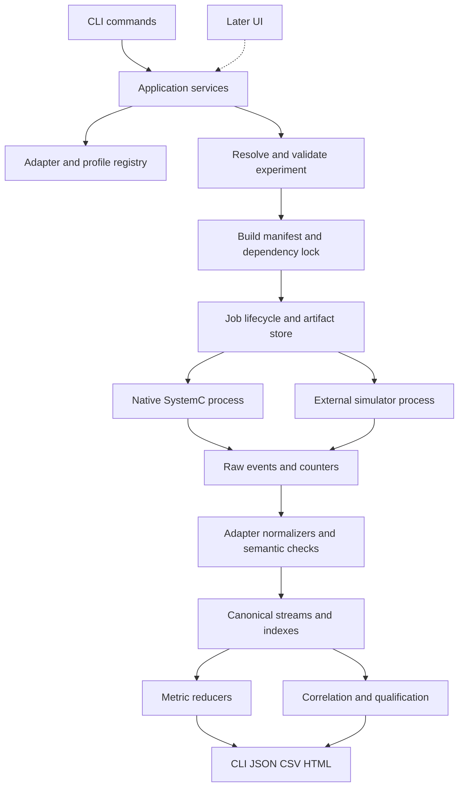
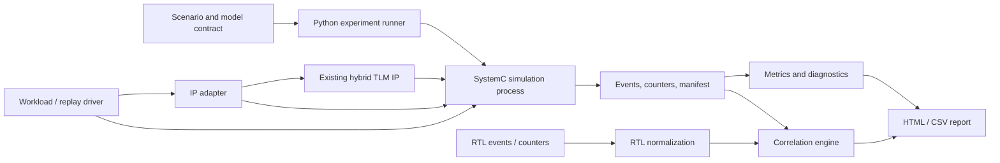

# Architecture

## Proposed production architecture

The sections below distinguish the current WDT path from the proposed generic
platform. Use [requirements](PRODUCT_REQUIREMENTS.md) for scope and
[data contracts](DATA_CONTRACTS.md) for v2 semantics. The existing code is retained
and gradually moved behind adapter interfaces; v1 behavior remains a regression.

### Proposed source layout and ownership

| Module/path to introduce | Responsibility and interface | Primary ticket |
|---|---|---|
| `tlm_lab/core/contracts`, `schemas/` | Version-dispatched validation and typed records, no model imports | B02 |
| `tlm_lab/core/registry.py` | Trusted package/profile discovery and capabilities | B03 |
| `tlm_lab/core/experiment.py` | Resolve defaults, references, units, prerequisites; immutable resolved inputs | B02/B05 |
| `tlm_lab/execution/` | Build/launch providers, process trees, job journal, cancellation | B07 |
| `tlm_lab/storage/` | Artifacts, hashes, chunks/indexes and analysis revisions | B04/B07 |
| `tlm_lab/analysis/` | Streaming reducers, metric prerequisites, confidence and comparison policies | B06/B08 |
| `tlm_lab/adapters/wdt/` | Move WDT config/normalization/RTL/metrics from current modules | B03 |
| `native/include/tlm_lab/`, `native/src/` | C++14 workload/observer/identity SDK; shared kernel integration | B03-B05 |
| `tlm_lab/adapters/<profile>/` | Model-specific configuration, workloads, launch, events and qualification | B09/B12 |
| `tests/unit`, `contract`, `integration`, `qualification`, `capacity` | Independent suite layers | B01 onward |
| `tlm_lab/application/`, `tlm_lab/cli.py` | Use cases and presentation; reusable by future UI | B10/B11 |

Paths are target design, not current directories. Avoid a single giant refactor:
introduce interfaces, wrap WDT, migrate one concern at a time, then delete obsolete
code only after legacy compatibility evidence. Core modules cannot depend on
WDT register constants, family names, protocol phases or four-byte assumptions.

### Simulation composition boundary

A native experiment constructs source drivers, existing IP adapters, explicit
bridges and sinks in one compatible SystemC kernel. All closed-loop feedback is
inside that process. Python controls jobs and offline analysis. Two IPs compiled
against incompatible ABIs cannot be directly bound; rebuild compatibly or keep
them as independent experiments until a separately reviewed co-simulation
transport exists. Parallel sweep processes do not make a distributed kernel.

Each bridge has a functional mapping, queue/capacity, delay owner, ordering rule,
clock-crossing policy and qualification record. Graph connections do not imply
that UALink, UCIe and PCIe can bind directly. Protocol-compatible ports can bind;
otherwise reject the topology unless an explicit adapter/bridge is supplied.
Named clock domains, physical link directions and accounting layers are preserved.

### Application and execution lifecycle

Resolve -> validate -> prepare -> build/verify binary -> launch -> drain/terminate
-> ingest -> validate evidence -> analyze -> correlate -> finalize -> report.
Every stage has a recorded outcome; failed preparation/build must also retain a
diagnostic record. Dry-run produces resolved inputs/commands without execution.
Job cancellation is idempotent and terminates descendants. Resuming a sweep
creates new run attempts; it never appends new simulation to an old kernel trace.

Use content hashes for reuse only when binary/dependencies, inputs, adapter,
normalizer and toolchain policy match. Hardware runtime benchmarking disables
cached execution. Do not cache an accuracy pass outside its qualification envelope.

### Failure and validity model

Track execution (`success`, `failed`, `cancelled`, `timeout`, `interrupted`),
evidence (`complete`, `partial`, `invalid`) and qualification (`uncorrelated`,
`pass`, `fail`, `inconclusive`) separately. Diagnostics may inspect invalid runs,
but incomplete required evidence cannot produce a trusted passing KPI gate.
Missing optional probes make dependent metrics unavailable. A timing discrepancy
with complete comparable evidence is an accuracy failure, not an infrastructure
error. Each result records toolchain compatibility separately from evidence.

### Future expansion seams

Keep metrics and application services independent of HTML and CLI parsing.
R3 adds constrained design-space exploration and catalog components above the
same adapters. R4 may add a local UI, calibrated power-state models and task
mapping. No cloud/database service is required for R1. OS process and path logic
lives behind providers so Linux qualification does not require rewriting analyses.

The WDT CLI path is implemented in `tlm_lab/` and `examples/wdt/scenario.cpp`.
Native simulation, observation, offline metrics, evidence, independent RTL,
comparison, and HTML/CSV reports are exercised. General external adapters,
link-IP queue/credit probes, and multi-IP topology remain extensions.

## Simulation boundary

Keep SystemC execution, workload feedback, and IP timing in one native simulation
process. Python configures and launches it and analyzes outputs after execution;
it does not schedule individual simulation transactions. Independent scenarios
run in separate processes. Parallel sweeps do not imply parallelizing one
SystemC kernel.

Use C++14 for the initial example and a matching SystemC library. A production
adapter may need the standard and compiler already required by its IP. Prefer
compile-time linking over a binary plugin ABI in the first version. Support an
external executable adapter when an IP must remain in its existing build or
commercial simulator environment.

## Adapter responsibilities

Each adapter declares ports and protocols, configuration fields, clock/reset
bindings, address map, extension ownership, timing rules, supported workload
operations, and probe locations. Capabilities are explicit: a boundary-only
model must not claim internal queue or credit visibility.

Do not enforce TLM base-protocol phases on custom protocols. For standard
`nb_transport` interfaces, record both call and return behavior, including
updated phases, timing annotations, and completion status. For `b_transport`,
record entry/return and whether the callee waited or returned annotated delay.
For signal interfaces, define the sampled edge and update visibility.

Inline monitors must forward all relevant transport paths and preserve binding,
DMI invalidation, debug transport, extensions, and payload lifetime. Begin with
explicit observation hooks inside the adapter where a transparent monitor cannot
be demonstrated. Inspecting a raw payload pointer after completion is forbidden;
copy small metadata at observation time.

## Observation and storage

Use a small C++ observer interface with an optional no-op implementation. Hooks
must not call `wait`, schedule IP events, change delays, acquire payload ownership,
or alter functional state. Expensive formatting is optional and can be deferred.
Snapshot IDs and scalar metadata, not proprietary payload content by default.

Proposed modes are counters-only, selected events, and full event trace. Record
mode and loss counts. Any data loss invalidates metrics that depend on the missing
events. A bounded trace never silently overwrites evidence while reporting exact
results. The pilot's synchronous CSV writer is for small tests, not the eventual
high-throughput capture path.

Start with CSV/JSON artifacts for inspection. Add an indexed format only after
profiling representative traffic volume. Maintain event schema versions and
migration rules independently of model versions.

## Runner and reproducibility

An immutable run directory should hold resolved configuration, workload/seed,
model and RTL revisions, adapter revision, build commands, toolchain and SystemC
versions, executable/input hashes, trace configuration, clock definitions, host
details, logs, termination reason, raw data, metric output, and comparison report.
Capture dirty-source hashes when a clean revision is unavailable.

Use argument arrays for subprocesses, explicit working directories, timeouts,
unique output directories, and process-tree cleanup. Record wall-clock timeout
separately from simulated timeout, normal drain, assertion, crash, and
configuration failure. A partial run is not a successful zero-throughput result.

## Analysis and presentation

Pure offline functions calculate metrics from canonical observations. Raw traces
are immutable; derived tables identify source run and analysis version. The
report shows run validity, scope of RTL qualification, workload, major KPIs,
latency/stall breakdown, and links to the first mismatch. Unsupported or
unobservable metrics are marked unavailable, never filled with zero.

The first UI is a CLI plus a portable HTML report. A dashboard is a later layer
over the same artifacts and APIs, after timing and correlation are trustworthy.

