# Development roadmap and release gates

Baseline: 2026-11-17, existing WDT code at `43ba848`. User priority is existing-IP
performance/RTL correlation, then multi-IP analysis; Windows/CLI first. This
roadmap supersedes the original M0-M5 sketch. M0 and the WDT portions of M1/M2/M4
are R0 evidence; they do not close generic infrastructure or real-link gates.

## Releases and dependencies

```mermaid
flowchart LR
  R0[Validated WDT R0] --> P0[P0 Intake and contracts]
  P0 --> P1[P1 Adapter and schema core]
  P1 --> P2[P2 Concurrent workloads and metrics]
  P2 --> P3[P3 Real IP correlation]
  P3 --> R1[R1 Single-link CLI release]
  R1 --> P4[P4 Additional profiles and composition]
  P4 --> R2[R2 Multi-IP release]
  R2 --> P5[P5 Architecture exploration]
  P5 --> R3[R3 Exploration release]
  R3 --> P6[P6 Optional UI and power]
```

| Phase | Deliverables | Entry/dependencies | Exit gate | Indicative engineering effort |
|---|---|---|---|---|
| R0 baseline | WDT build/trace/RTL, CLI, seed sweep, report/replay | Existing repo | Preserve current documented regressions | Already implemented |
| P0: scope and intake | IP evidence sheets, selected first profile, policy/host/toolchain decisions, schemas draft | Owner access to one candidate model and RTL | G0: documented model boundary, build path, ownership and KPI questions; unknowns have owners | 1-2 person-weeks |
| P1: extensible core | Schema/version dispatch, WDT adapter, native/external SDK, build/run state machine foundation | P0 contracts; production specifics can proceed in parallel | G1: v1 golden equivalence, adapter conformance and two launch modes | 3-5 person-weeks |
| P2: concurrent analysis | Synthetic link, source/sink drivers, generic events/reducers, trace scale, policy comparator | P1 interfaces | G2: analytical concurrency/resource tests and negative controls pass; evidence budgets measured | 5-8 person-weeks |
| P3: first existing link | Real adapter/probes/importer, calibration/holdout matrix, CLI packaging/docs | G0 real-IP readiness; G2; independent RTL evidence | G3/R1: selected real link passes agreed latency/load/contention/backpressure/holdout gates on supported Windows toolchain | 4-8 person-weeks plus external model/RTL work |
| P4: other profiles and systems | Remaining family adapters, explicit bridges/topology, multi-clock lineage, system tests | R1 and per-IP access | G4/R2: each advertised profile qualified; at least one meaningful shared-resource multi-IP path correlated | 8-16 person-weeks, excluding new protocol/bridge modeling |
| P5: architecture exploration | Catalog components, constrained sweeps, sensitivity/Pareto, workload mapping, scalable evidence search | G4, representative capacity workloads | G5/R3: reproduce and explain an architecture tradeoff across qualified alternatives | 6-12 person-weeks |
| P6: optional expansion | Interactive UI, calibrated power/energy, optional software/AI importers and Linux qualification | User scope decision and supporting models/toolchains | G6/R4: separate UI parity, energy calibration and port validation gates | Estimate after scope and data availability |

Estimates are planning ranges, not commitments. They assume working TLM/RTL
models, permission to instrument, and engineers familiar with SystemC. R1 totals
approximately 13-23 person-weeks before external model fixes. One engineer faces
roughly that many productive work weeks plus integration delays; a team cannot
divide it mechanically because contract and qualification work is sequential.
R2/R3 estimates exclude creating missing production IPs, proprietary bridges,
memory models or obtaining simulator licenses. Re-estimate after G0 and the first
adapter. No delivery date or team staffing has been confirmed.

## Workstreams and ownership

| Role | Responsibilities | Review partner |
|---|---|---|
| Platform developer | Schemas, runner/storage, CLI, analysis, packaging | TLM/performance owner |
| TLM integration owner | Model timing contract, SDK, drivers, probes and mechanism fixes | RTL owner |
| RTL/verification owner | Independent stimulus/monitors, semantic matching, directed/stress/holdout evidence | Performance owner |
| Performance owner | KPI definitions, load envelope, tolerance and precision policy, qualification sign-off | Model/RTL owners |

Roles may be held by fewer people, but RTL expected behavior must remain
independent of the TLM implementation. Estimates count total engineering effort,
not just platform coding. UI expertise is needed only after R3 scope selection.

## First implementation increments

1. **Intake and baseline:** B01; gather three candidate worksheets, pin WDT
   fixtures, choose one first-link profile. If no model is ready, continue P1/P2
   and leave G3 blocked by evidence, not falsely completed with a synthetic model.
2. **Generic skeleton:** B02/B03/B07 foundation; preserve v1, add schemas/registry,
   versioned preparation/launch and interrupted-run evidence. Do not add production
   protocols by scattering family-name branches through the core.
3. **End-to-end synthetic experiment:** B04/B05/B06; two concurrent flows,
   finite credits/queues and independently expected throughput/accounting.
4. **Independent accuracy pipeline:** B08 with synthetic negative controls,
   then B09 for one real profile and real RTL monitor.
5. **R1 operational release:** B10/B11 and G3 evidence, install/run from a clean
   Windows host. Publish remaining unavailable metrics and unsupported settings.

## Gate evidence and stop conditions

G0 needs enough information to write a correct adapter; lack of exact protocol
revision/timing ownership blocks integration. Missing internal probes only blocks
dependent metrics. Missing RTL evidence blocks accuracy qualification, not
uncorrelated model experiments. Owner decisions and blockers live in [DECISIONS](DECISIONS.md).

G1/G2 cannot close if a v1 regression changes unexplained, trace loss is hidden,
independent reordering fails or accounting inflates useful bytes. G3 cannot close
on directed low-load agreement alone. G4 requires interaction tests that reveal
shared-resource contention; placing two isolated models in a diagram is insufficient.
G5 needs qualified alternatives, not just many runs. G6 power claims require a
calibration source and uncertainty budget.

Use [BACKLOG](BACKLOG.md) for tickets, [VERIFICATION_PLAN](VERIFICATION_PLAN.md)
for evidence and [PRODUCT_REQUIREMENTS](PRODUCT_REQUIREMENTS.md) for scope.
Every gate record lists passed, failed, inconclusive and excluded cases separately.

## Risks and contingencies

| Risk | Early indicator | Response |
|---|---|---|
| Unknown payload/timing ownership | No nonzero-delay/reuse example | Intake/code review before wrapper; fixture testing |
| No usable RTL baseline | No equivalent workload or stable monitor IDs | Build importer/exporter workstream; retain uncorrelated status |
| Model lacks contention mechanisms | Rate changes do not affect queues/service | Explicit model-development ticket and restricted envelope |
| Probe overhead/trace volume | RSS/disk grows with trace; timing digest changes | Bounded capture, streaming analysis and AT17; preserve evidence limits |
| Proprietary tool/ABI dependence | Build works only in owner's shell | External provider and dependency preflight; scoped qualification |
| Multi-IP scope expands unexpectedly | Incompatible protocols/clock interfaces | Inventory bridge work separately; qualify one path first |
| Superficial competitor parity target | Feature checklist without testable use cases | Compare accepted experiments/KPIs, not UI similarity or invented percentages |
